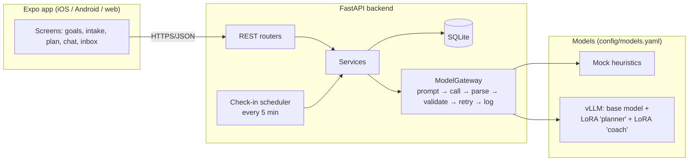

# Architecture

my_planner has three layers:

1. **Expo app** (`frontend/`): one TypeScript codebase for iOS, Android and web.
2. **FastAPI backend** (`backend/`): accounts, goals, plan storage, progress tracking, chat, the check-in scheduler and notifications.
3. **Models**: two fine-tuned open-source LLM roles (Planner, Coach). The backend reaches them through one gateway, so a model can be a built-in mock or a real model behind an OpenAI-compatible server (vLLM, Ollama, ...).

## The models and where they are used

| Task | Role | Called when | Output |
|---|---|---|---|
| `planner.interview` | Planner | Goal created, and after each intake answer | Next question (`ask`) or `finish` with a normalized profile |
| `planner.generate` | Planner | Intake finished | A `Plan` JSON: milestones, tasks with schedules, metrics, tips, safety notes |
| `planner.revise` | Planner | User asks for a change, a new constraint, low adherence, ahead or behind schedule, weekly review | `should_revise` plus a list of edit operations plus a user-facing explanation |
| `coach.chat` | Coach | Every user chat message | Reply text |
| `coach.checkin` | Coach | The scheduler decides to reach out, and once when the plan is created | A short proactive message |
| `coach.extract` | Coach | Every user chat message, before the reply | Events: task done/partial/skipped, metric value, constraint, change request, mood, safety concern |
| `coach.summarize` | Coach | The chat outgrows the context window | Rolling memory summary |

The rule throughout: **models produce language and JSON, and code makes the decisions.** Check-in timing, applying plan edits, auto versus ask mode, progress math, safety overrides and rate limits are all deterministic code.

## Main flows

### 1. Intake → plan
`POST /goals` stores the user's goal, current state, deadline, available time, answer format, update mode and check-in settings. It then calls `planner.interview` for the first question. Each answer goes to `POST /goals/{id}/intake/answer`, which records it and asks for the next question. The interview ends when:
- the model returns `finish`,
- the question budget (`PLANNER_INTAKE_MAX_QUESTIONS`, default 10) runs out,
- the model repeats a field, or
- the user presses "finish now".

After that, rule-based safety checks run on the profile: minors, underweight BMI targets, health conditions and signs of disordered eating each add `safety_flags`. Every later model call receives these flags.

`POST /goals/{id}/plan/generate` calls `planner.generate`, clamps the dates to today and the deadline, checks time fit and weight-loss rate, and saves plan version 1. The Coach then posts a `plan_ready` welcome message.

### 2. Chat
`POST /goals/{id}/chat` runs these steps in order:
1. **Crisis check** (regex, Hebrew and English). On a match the reply is a fixed, safe message with real hotlines (ERAN 1201, 988, emergency numbers), and no model is called.
2. **`coach.extract`** pulls structured events out of the message.
3. **The app applies the events.** It writes task logs (for plausible dates only, up to 7 days back) and metric logs, stores constraints and adds safety flags. It records each change as a human-readable `actions_taken` entry.
4. **`coach.chat`** writes the reply. Its context holds the plan overview, today's tasks, adherence, streak, memory, constraints, `actions_taken`, any pending revision and the safety flags.
5. **In the background:** `planner.revise` runs if the user asked for a change or reported a constraint, and `coach.summarize` runs when the history is long.

### 3. Plan revisions
`planner.revise` returns edit operations (`add_task`, `update_task`, `remove_task`, `add_milestone`, …, `update_plan`) rather than a full plan. Small models handle short edits more reliably than rewriting a whole plan, and the edits make an easy diff to show the user. The app applies the operations to a copy of the plan and re-validates the whole document. If any operation is invalid, it asks the model once more, including the error. Then:
- **Auto mode:** a new plan version is saved immediately, and a `revision_applied` message and notification follow.
- **Ask mode:** a `revision_proposal` message and notification follow. The user approves or rejects it. Approving re-applies the operations to the *current* plan, so a stale proposal can't break anything.

Automatic reviews (low adherence, ahead or behind schedule, weekly) have cooldowns, and never run while another proposal is pending.

### 4. Proactive check-ins
`services/checkins.py:tick()` runs every `PLANNER_SCHEDULER_INTERVAL_SECONDS`, or on demand through `POST /dev/tick {"now": ...}` for demos. For each active goal, in the user's timezone, it:
- respects quiet hours, `max_per_day` and "the user is active right now";
- checks the daily trigger first. After `daily_time`, it sends `daily_tasks` ("did you exercise today?") or `all_done`;
- during the day, checks `missed_yesterday`, `milestone_upcoming`, `deadline_near`, `inactivity` and `metric_reminder`. One slot is kept for the evening check-in;
- de-duplicates every trigger with a key (for example `daily:2026-10-28`).

The Coach writes the message (`coach.checkin`). It goes into the chat and the notification inbox, and out as an Expo push when `PLANNER_PUSH_ENABLED=true`. When the user replies "yes!", `coach.extract` resolves it against the check-in question and logs the task.

## Data model (SQLite through SQLAlchemy)
`users`, `goals` (settings, profile, safety flags, constraints, memory), `intake_turns`, `plan_versions` (each plan is a JSON document validated by `contracts.Plan`), `plan_revisions`, `task_logs` (by stable task id and date, so logs survive revisions), `metric_logs`, `chat_messages`, `checkin_logs`, `notifications`, `push_tokens`.

## Hebrew and English
- Every model input carries a `style` with an explicit `language`. `answer_format.language = "auto"` resolves to the language of the goal text (for the Planner) or of the user's latest message (for the Coach).
- The prompts instruct the model to write user-facing text in that language. Internal fields (`text` of extracted events, memory summaries) are in English.
- The app switches the whole layout to right-to-left in Hebrew. Each chat bubble also sets its text direction from its own content, so mixed conversations render correctly.

## Swapping in the real models
Edit `backend/config/models.yaml`: set `backend: openai`, `base_url` and the adapter name for each task. Nothing else changes. With `structured_output: json_schema`, the JSON Schema of each task is sent, so vLLM uses constrained decoding and output is always well-formed. Every call is logged in chat format to `backend/data/llm_logs/<task>.jsonl` for evaluation and for adding to the training data.
